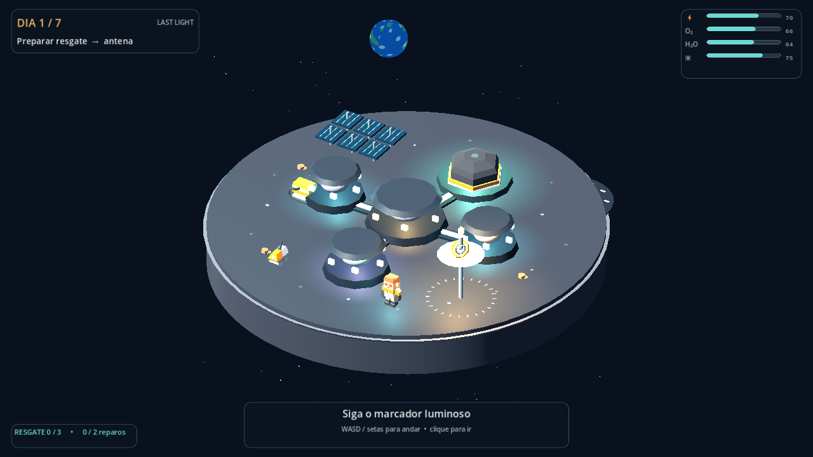
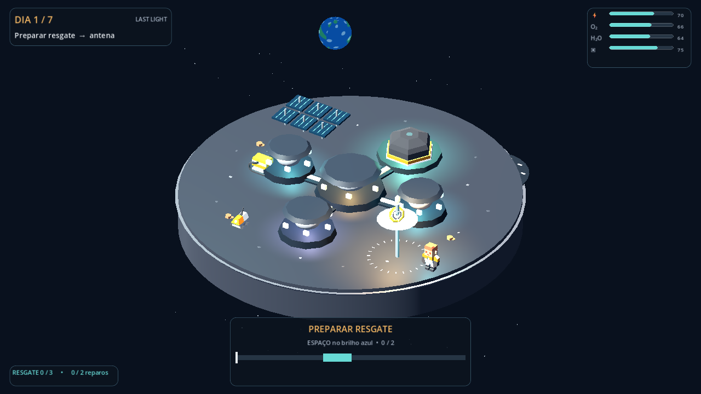

# LAST LIGHT

Jogo curto de exploração e sobrevivência lunar para Godot 4.7. Caminhe pela base, repare seus sistemas e prepare três etapas de resgate antes do fim do sétimo dia. Todo o texto do jogo está em português.



## Jogar

1. Instale o [Godot 4.7](https://godotengine.org/download/windows/) ou use a versão executável, se incluída na entrega.
2. Abra esta pasta como projeto no Godot e execute com **F5**.
3. Clique em **Iniciar missão**. Siga o marcador luminoso até o módulo indicado no objetivo.
4. Use **WASD** ou as **setas** para andar. Também é possível clicar no cenário ou em um módulo para caminhar até ele.
5. Perto de um módulo, pressione **E** para iniciar o reparo. Pressione **Espaço** quando o ponteiro cruzar a faixa azul duas vezes. Um erro permite tentar novamente sem gastar a ação.
6. Depois dos reparos, volte ao habitat e pressione **E** para encerrar o dia. **Esc** pausa ou cancela a calibração.



O jogo salva automaticamente após cada reparo e a cada mudança de dia. A opção **Continuar** retoma a campanha.

## Regras rápidas

- Energia, oxigênio, água e suprimentos precisam ficar acima de zero.
- O abrigo precisa de integridade **60 ou mais** ao terminar o dia 4.
- Conclua as **três etapas do resgate** antes de terminar o dia 7.
- O marcador e a frase no canto superior esquerdo mostram o próximo reparo sugerido. Você também pode escolher outro módulo.
- Luzes vermelhas sinalizam avarias; os quatro indicadores compactos mostram os recursos vitais.
- A anomalia do dia 3 é uma investigação científica opcional que aumenta a pontuação.

Os números são **unidades didáticas de jogo**, não medições de uma missão real. Consulte [mecânicas](docs/GAME_DESIGN.md) e [ciência](docs/SCIENCE.md).

## Estrutura

- `scripts/mission_config.gd`: custos, ganhos, textos e referências curtas.
- `scripts/mission_model.gd`: regras, eventos, turnos, vitória e derrota.
- `scripts/save_manager.gd`: save em `user://`.
- `scripts/lunar_diorama.gd`: base lunar 3D, astronauta e sinais de avaria.
- `scripts/main.gd`: caminhada, calibração, objetivos, interface e campanha.
- `scripts/soundscape.gd`: trilha e efeitos sonoros gerados por código.
- `assets/kenney_space_kit/`: modelos 3D CC0 com licença incluída.
- `tests/`: verificações automatizadas.

## Testes

Com `godot` no PATH, a partir desta pasta:

```text
godot --headless --path . --script res://tests/model_test.gd
godot --headless --path . --script res://tests/ui_test.gd
godot --headless --path . --script res://tests/assets_test.gd
godot --headless --path . --script res://tests/balance_test.gd
```

Veja os resultados executados em [TEST_REPORT.md](docs/TEST_REPORT.md).

## Exportação

Abra o projeto no Godot 4.7. Em **Projeto > Exportar**, instale os templates **da mesma versão** do editor. Exporte os presets **Windows Desktop** e **Web** para `build/`. O renderizador é **GL Compatibility**, adequado ao caminho WebGL do Godot 4. O jogo não requer servidor ou API; a build web pode precisar de um servidor HTTP local para ser aberta no navegador, conforme as regras do navegador.

O [workflow de builds no GitHub](https://github.com/EduardoFagionatoFonseca/Nasa-space-challange-Last-Light/actions/workflows/build.yml) executa os testes e publica os pacotes Windows e Web como artefatos. Abra uma execução concluída para baixá-los. Os artefatos expiram conforme a política do GitHub; o projeto e os presets permanecem no repositório para nova exportação.

## Créditos

Conceito, código, interface, terreno 3D e áudio procedural foram criados para LAST LIGHT. Modelos selecionados do [Kenney Space Kit](https://kenney.nl/assets/space-kit), licença **CC0**: veja [License.txt](assets/kenney_space_kit/License.txt) e [ASSETS.md](docs/ASSETS.md). Motor: Godot 4.7. Fontes científicas públicas da NASA constam em [SCIENCE.md](docs/SCIENCE.md). Este jogo é um projeto independente e não é afiliado nem endossado pela NASA.
